# ptop

ptop is a small program done for systems programming course that lists and monitor processes live CPU (GPU version, like nvidia-smi wasnt created due to the lack of time), written in C. Was testes and worked on Linux Ubuntu 24.04.5. It shows usage of each CPU core, followed by a table of processes with their PIDs, user state, CPU %, memory and name.

It can work in two modes:
    - **Snapshot (default):** prints the table once and exits.
    - **Live (`-w`):** redraws the table on a timer until you quit.

CPU usage is the change between two readings, so a snapshot waits 500 ms between them. A process
that uses more than one core can show more than 100%

## Main commands:

### Build and test

| Command | What it does |
|---|---|
| `make` | Builds `./ptop` |
| `make test` | Builds and runs the unit tests |
| `make debug` | Builds `build/debug/ptop` with AddressSanitizer and UBSan |
| `make format` | Formats the code with clang-format |
| `make clean` | Removes the build output |

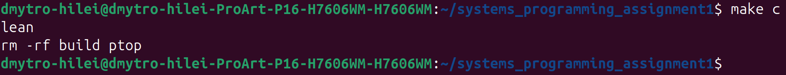

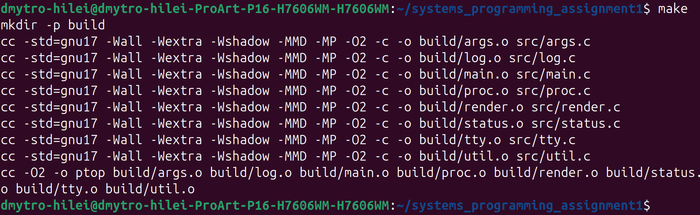

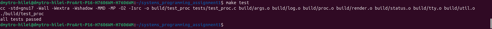

### Running ptop

| Command | What it does |
|---|---|
| `./ptop` | Shows all processes, sorted by CPU |
| `./ptop -n 5` | Shows only the first 5 processes |
| `./ptop -s cpu` | Sorts by CPU, highest first (the default) |
| `./ptop -s mem` | Sorts by memory, highest first |
| `./ptop -s pid` | Sorts by PID, lowest first |
| `./ptop -w 1` | Live mode, refreshes every second (1 to 86400 seconds allowed) |
| `./ptop -w 2 -s mem -n 15` | Options can be combined |
| `./ptop -v` | Also prints debug messages to stderr, such as processes that exited during a read |
| `./ptop --help` | Prints the usage text |

In live mode, press `q` or Ctrl-C to quit. SIGTERM also stops it cleanly. The terminal is restored
in all three cases. If stdin or stdout is not a terminal, ptop prints a warning and one snapshot.

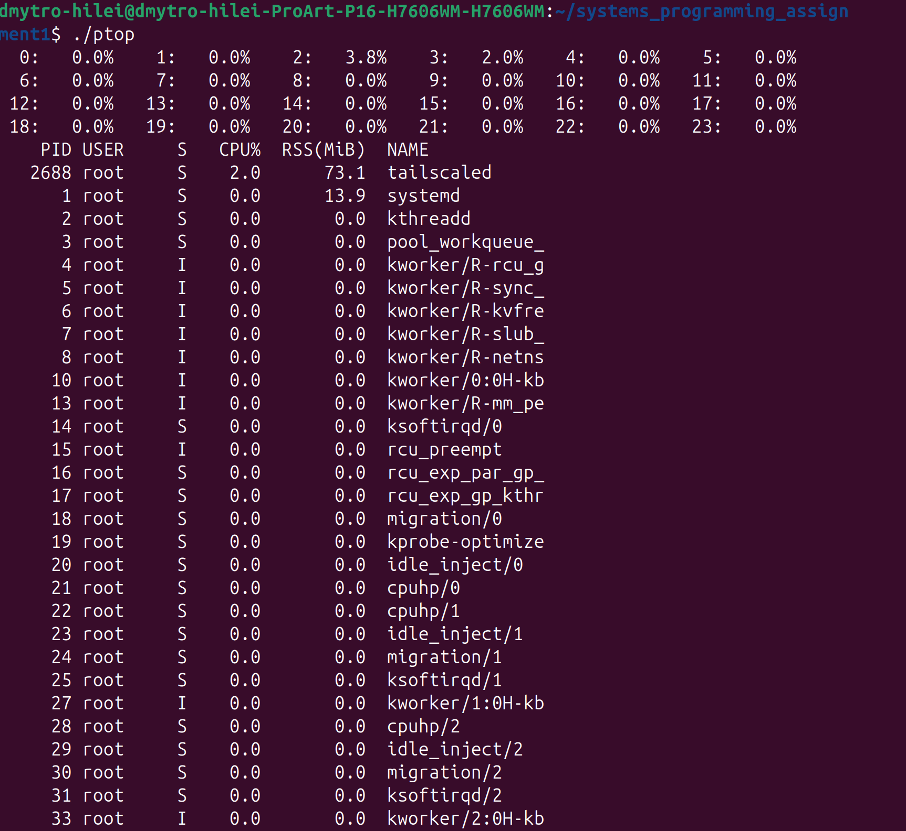

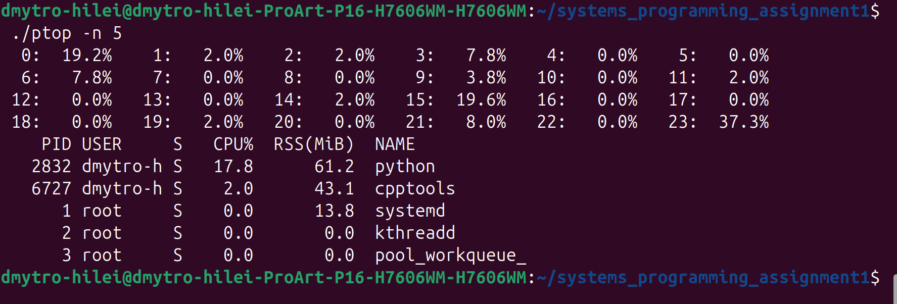

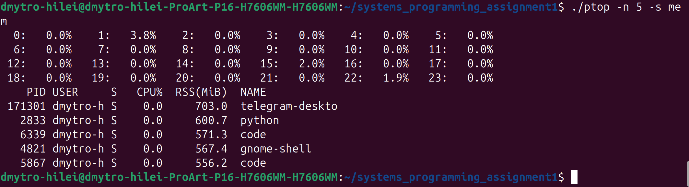

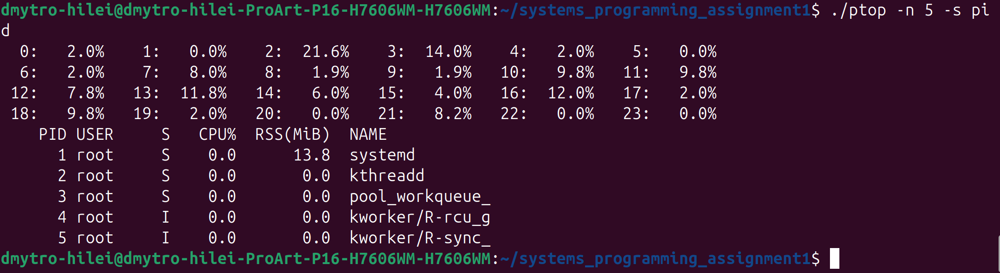

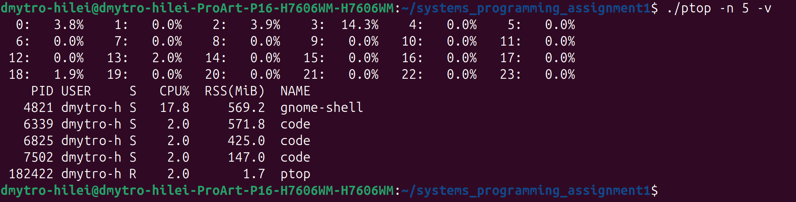

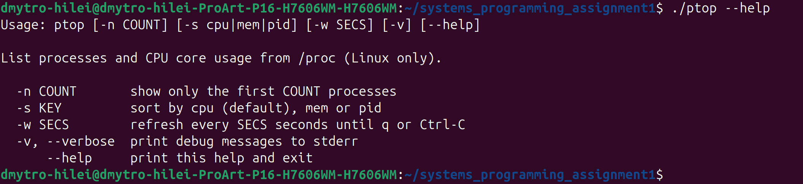

## Error handling

### Exit codes

| Code | Meaning |
|---|---|
| 0 | Success, including when the reader closes the pipe (`./ptop \| head -2`) |
| 1 | Runtime error, such as `./ptop > /dev/full` |
| 2 | Invalid command line, such as `./ptop -n abc` |

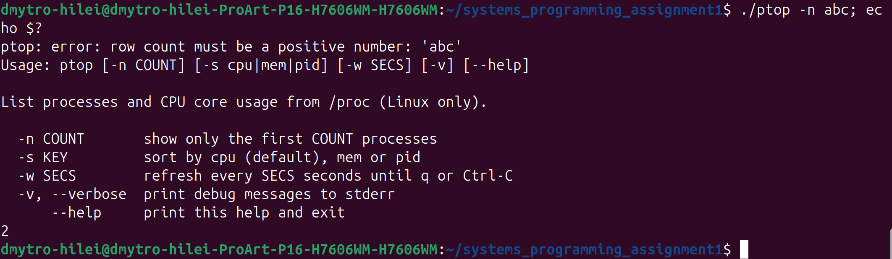

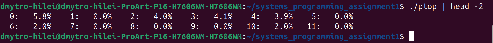

![echo ${PIPESTATUS[0]}](docs/screenshots/13-pipestatus.png)

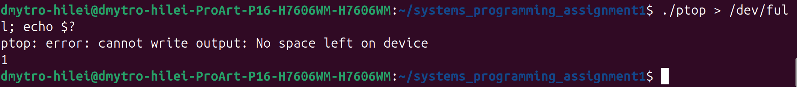

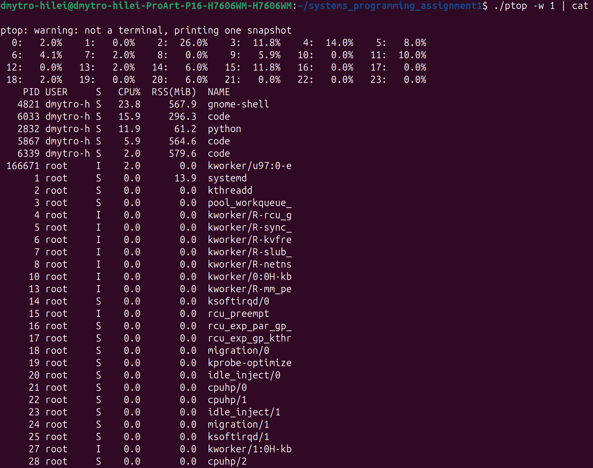

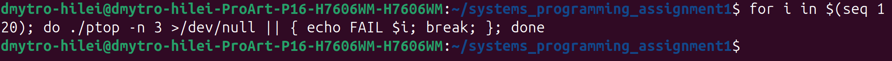

## Memory checks

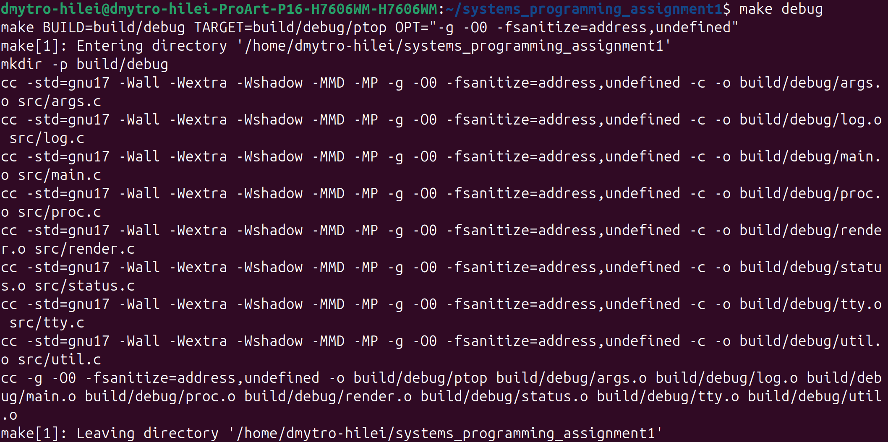

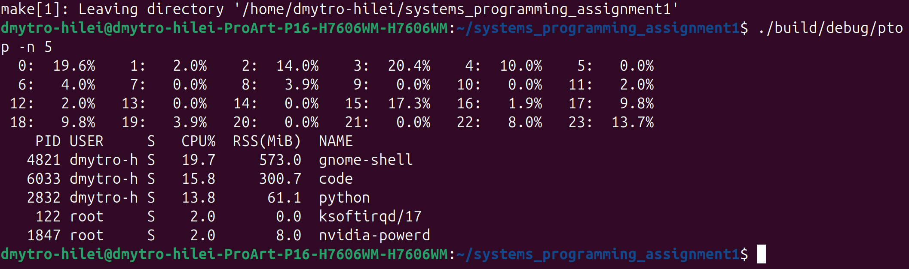

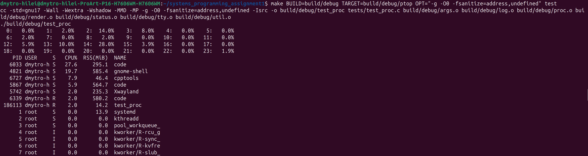

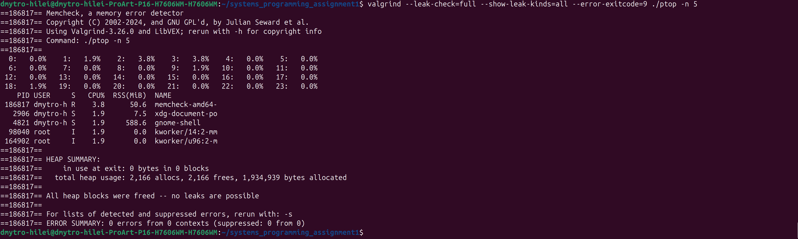

## Code overview

### `src/main.c`: program flow

- `main`: parses options, ignores SIGPIPE, picks the mode and sets the exit code.
- `on_signal`: sets a stop flag when SIGINT or SIGTERM arrives.
- `install_signals`: installs that handler.
- `sample_init`, `sample_free`: set up and release one reading of processes and cores.
- `sample_read`: reads the processes and cores and records the time.
- `sample_compute`: calculates CPU usage from two readings and sorts the result.
- `run_snapshot`: takes two readings 500 ms apart and prints one table.
- `live_loop`: repeats waiting for a key, reading, calculating and drawing.
- `run_live`: enters live mode, or falls back to a snapshot, and always cleans up.

### `src/args.c`: command line

- `args_parse`: reads the options into `struct options` and rejects invalid values.
- `parse_sort`: turns `cpu`, `mem` or `pid` into a sort key.
- `args_usage`: prints the usage text.

### `src/proc.c`: reading `/proc`

- `proc_list_init`, `proc_list_free`: set up and release a process list.
- `proc_list_read`: reads every process in `/proc` and skips those that have exited.
- `read_one`: reads the owner and stat line of one process.
- `process_error`: separates "process is gone" from a real system error.
- `proc_list_push`: adds a process, growing the array when needed.
- `proc_parse_stat`: parses one `/proc/<pid>/stat` line. The name ends at the last `)`, because it
  can contain spaces and brackets.
- `proc_compute_cpu`: calculates each process's CPU % from the tick change between two readings.
- `proc_list_sort`: sorts the list by the chosen key.
- `cmp_pid`, `cmp_cpu`, `cmp_mem`: comparison functions for `qsort`.
- `core_list_init`, `core_list_free`: set up and release a core list.
- `core_list_read`: reads the per-core lines of `/proc/stat`.
- `core_parse_stat`: parses one `cpuN` line into busy and total ticks.
- `core_list_push`: adds a core, growing the array when needed.
- `core_compute_usage`: calculates each core's usage between two readings.

### `src/render.c`: output

- `render_screen`: prints the core usage, header and process rows.
- `render_flush`: flushes the output and reports write errors.
- `print_cores`: prints the core usage, fitted to the screen width.
- `print_row`: prints one process and replaces control characters in its name with `?`.
- `print_line`: prints a line, cut to the terminal width in live mode.
- `user_name`: turns a UID into a user name, or prints the number if there is none.
- `write_error`: treats a closed pipe as normal and logs any other write error.

### `src/tty.c`: terminal control

- `tty_enter`: turns off echo and line buffering, then opens the alternate screen.
- `tty_leave`: restores the terminal. It also runs at exit.
- `tty_size`: gets the terminal size, or uses 24x80.
- `tty_wait_key`: waits for a key or until the timeout.
- `tty_frame_begin`: moves the cursor to the top left before a redraw.
- `tty_frame_end`: clears whatever is left below the new frame.

### `src/util.c`: helpers

- `parse_long`: checks that a whole string is a number within a range.
- `sleep_ms`: sleeps for a number of milliseconds, resuming if a signal interrupts it.
- `now_sec`: returns the monotonic time in seconds.

### `src/log.c`: messages

- `log_set_level`: sets how much is printed.
- `log_message`: prints a message to stderr.
- `log_errno`: prints a message followed by the system error text.
- `log_write`: formats and prints the line for the two functions above.
- `level_word`: turns a log level into a word such as `error`.

### `src/status.c`: errors

- `ptop_get_error_message`: turns an error code into readable text.

### `tests/test_proc.c`: unit tests

- `test_name_with_paren`: parses a process name containing spaces and `)`.
- `test_zero_rss`: parses a process with zero memory.
- `test_long_name_is_cut`: checks that long names are cut to 15 characters.
- `test_malformed`: checks that broken lines return a parse error.
- `test_cpu_percent`: checks CPU % for normal, new and reused PIDs.
- `test_sort`: checks all three sort orders.
- `test_core_parse`: checks parsing of a `cpuN` line, valid and too short.
- `test_core_usage`: checks core usage, including a core that went offline.

## Known limits

- Process names are cut to 15 characters and user names to 8.
- RSS can differ from `ps` by a few MiB on busy processes. The cause has not been confirmed.
- If a signal arrives just before the program starts waiting, ptop can take up to one interval to
  stop.
- Pressing any other key in live mode restarts the wait, so holding a key delays the next refresh.